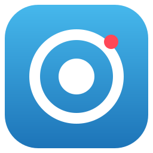
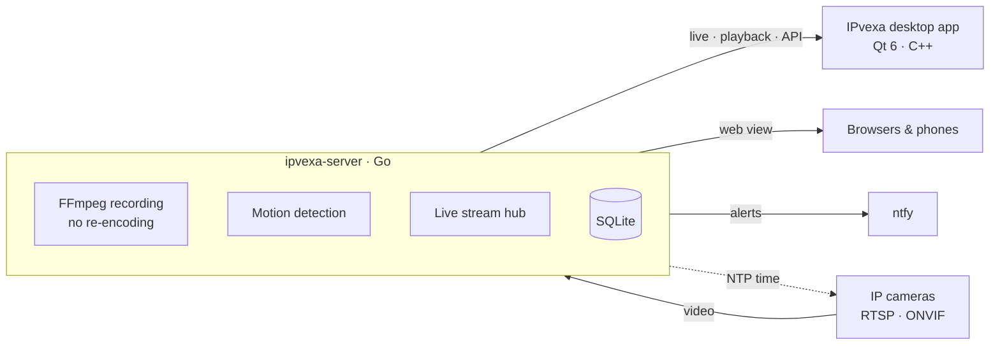

<div align="center">



# IPvexa

**Self-hosted video management for IP cameras. Private, offline, and fast.**

Continuous and motion recording · native desktop app · synced multi-camera playback · web and phone access

[](LICENSE)


[Features](#features) · [Install](#install) · [Usage](#usage) · [Web & phones](#web-and-phones) · [Configuration](#configuration) · [Development](#development) · [Roadmap](PLAN.md)

</div>

---

IPvexa records your cameras around the clock or only on motion, and gives you a native desktop app with free-form layouts and synced playback on a zoomable timeline. Browsers and phones get a lightweight web view, and alerts go to the ntfy phone app.

Everything runs on your own hardware. IPvexa never contacts the internet: there are no accounts, no cloud and no containers.

## Features

| | |
|---|---|
| **Recording** | Continuous or motion-only recording with no re-encoding, so quality is untouched and CPU use stays low. Weekly schedules, per-camera retention, storage limits, and a second disk if you want one. |
| **Live view** | Free-form layouts with resizable tiles, auto-arrange, digital zoom, tours and video walls on extra monitors. A distraction-free full-screen mode shows only the cameras. Live video stays in real time. |
| **Playback** | Synced playback of every camera on a zoomable timeline, at 1–16× speed, in reverse and frame by frame. It includes thumbnail previews, bookmarks and clip export. |
| **Motion** | Motion detection that learns and ignores swaying trees and flags. It has masks, sensitivity control, and **smart search** that finds motion in any area you draw. |
| **Cameras** | Works with Dahua/Amcrest, Hikvision/Annke, Reolink, OpenIPC, Thingino and any RTSP or ONVIF camera. ONVIF discovery and stream detection, plus PTZ with presets. |
| **Hardware decoding** | NVIDIA (NVDEC), Intel/AMD (VAAPI) and Apple (VideoToolbox), with automatic fallback to the CPU. |
| **Time sync** | The server is the cameras' time server (NTP) and corrects any camera clock that drifts, so every camera shows the same time. |
| **Web & phones** | A no-install web view with live video, playback and events. Phone alerts through ntfy include a snapshot and open the exact moment. |
| **Users** | Administrator, operator and viewer roles, with per-camera access, playback, PTZ and export permissions, and an audit log. |

## Install

### Linux

Ubuntu, Kubuntu, Debian or Arch. From a clone of this repository:

```bash
git clone https://github.com/narl3yyy-svg/IPvexa.git
cd IPvexa
./install.sh
```

The installer sets up the build tools (it asks for your sudo password), builds IPvexa and installs it as packages: `.deb` on Ubuntu and Debian, `makepkg` on Arch. The server runs as a system service under its own `ipvexa` user and starts at boot. **IPvexa** appears in the app menu.

When it finishes, it prints the first sign-in password and the address for browsers and phones.

<details>
<summary><b>Installer options</b></summary>

| Command | What it does |
|---|---|
| `./install.sh` | Install or upgrade the server and the desktop app |
| `./install.sh --client` | Desktop app only, to view a server on another machine |
| `./install.sh --server` | Server only, for a headless machine |
| `./install.sh --import-dev` | Also move a development setup (cameras, users, recordings) into the installed server |
| `./uninstall.sh` | Remove the programs. Recordings, cameras and settings are kept |
| `./uninstall.sh --purge` | Remove everything, including all recordings and settings |

You can also build packages yourself: `./scripts/build-deb.sh` writes them to `dist/`, and `packaging/arch/PKGBUILD` works with `makepkg -si`.

</details>

### macOS (Apple silicon)

M1 or newer. Install [Homebrew](https://brew.sh) first, then:

```bash
git clone https://github.com/narl3yyy-svg/IPvexa.git
cd IPvexa
./installmac.sh
```

The installer adds Go, Qt and FFmpeg with Homebrew. The server is installed as a background service that starts with the Mac, and **IPvexa.app** goes in `/Applications`. The first time the app opens, macOS asks for local network access: choose **Allow**.

<details>
<summary><b>Installer options</b></summary>

| Command | What it does |
|---|---|
| `./installmac.sh` | Install or upgrade the server and the desktop app |
| `./installmac.sh --client` | Desktop app only |
| `./installmac.sh --server` | Server only |
| `./installmac.sh --uninstall` | Remove the programs. Recordings and settings are kept |
| `./installmac.sh --purge` | Remove everything, including all recordings and settings |

The app uses Homebrew's Qt and FFmpeg, so run the installer again after `brew upgrade`. Intel Macs are not supported.

> [!NOTE]
> The macOS installer is new and has not yet been run on a real Mac. Please open an issue if anything goes wrong.

</details>

### Updating

```bash
git pull && ./install.sh        # Linux
git pull && ./installmac.sh     # macOS
```

You can update while IPvexa is running. The server restarts by itself, with a few seconds' break in recording. Reopen the desktop app afterwards.

## Usage

Open **IPvexa**, sign in with the password the installer printed, and change it from the user menu.

<details open>
<summary><b>Cameras and layouts</b></summary>

- **Add a camera:** click **+ Add camera** in the tree, pick the brand, and enter the address and login. **Detect streams** reads the stream addresses over ONVIF, and **Find cameras** scans the network.
- **Layouts:** drag cameras onto the grid.
  - Drag a tile to move or swap it, or drag its corner to resize it.
  - Drag the border between two tiles to change their sizes. Double-click a border to make them equal again.
  - **Auto-arrange** fills the screen with no empty tiles.
  - Layouts are tabs and save automatically.
- **Tiles:** hover over a tile for its toolbar: smart search, info, full screen, settings and remove.
  - Double-click a tile to maximize it.
  - The scroll wheel zooms; drag to pan.
  - Right-click for **Maximize frames** (no black bars), **Stretch video to tiles**, or **Open zoomed area as new tile**.
- **Full screen:** the toolbar button (or **F11**) shows only the live cameras, edge to edge. Double-click a camera there to fill the screen with it. **Esc** goes back.
- **Tours and video walls:** **Tour** cycles through the layout tabs. To put a layout on another monitor, right-click its tab and choose **Show full screen on**.

</details>

<details>
<summary><b>Live view quality</b></summary>

- **Quality:** **Auto / High / Low** in the toolbar applies to the whole layout. Each tile's **AUTO/HD/SD** button overrides it.
- **Live smoothing:** **Fast / Smooth / Smoothest** trades a little delay for even motion. *Smooth* (about 0.6 s) suits most Wi-Fi cameras; *Smoothest* (about 2.5 s) hides longer Wi-Fi pauses. If the app falls behind for a moment, it catches up to real time within a second or two.
- **On-demand streams:** high-quality streams are only pulled while someone watches them (unless they are being recorded). That halves the load on Wi-Fi cameras.
- **Hardware decoding:** the tile's info shows which decoder is in use (NVDEC, VAAPI, VideoToolbox or CPU). With an NVIDIA GPU, the server also runs motion detection on the GPU. Set `IPVEXA_NO_HWDEC=1` to use the CPU only.

</details>

<details>
<summary><b>Timeline and playback</b></summary>

- **Colors:** green is recorded footage, red is motion and amber flags are bookmarks.
- **Navigating:** scroll to zoom, drag to pan, click to jump. Hover over footage for a picture preview. Clicking the date opens a calendar.
- **Bookmarks and clips:** right-click the timeline to bookmark a moment or export a clip.
- **Sync:** plays every camera on the layout at the same moment. With Sync off, only the selected camera plays back and the others stay live.
- **Controls:**
  - **◀ ▶** jump between events, and **◂◂** plays backwards.
  - **‹| |›** (or **,** and **.**) step one frame.
  - **Space** plays and pauses, **← / →** jumps 10 seconds, and **L** goes live.

</details>

<details>
<summary><b>Motion detection and recording</b></summary>

- **Motion:** camera settings › **Motion** turns detection on, sets the sensitivity and lets you paint areas to ignore. Things that keep moving in place, such as trees and flags, are learned and ignored. Motion only counts once something moves across the picture or comes closer.
- **Recording:** *Always* or *Only when there's motion*. Motion-only recording keeps 10 s before and after each event; the buffer is adjustable.
- **Schedules:** a weekly schedule can switch the mode at set times.
- **Low-quality stream:** **Also record the low-quality stream** makes playback in small tiles smooth.
- **Smart search:** click the magnifier on a tile and drag a box. The timeline then shows only motion inside it.

</details>

<details>
<summary><b>Users and permissions</b></summary>

- **Managing users:** user menu › **User management**.
- **Roles:** Administrator, Operator and Viewer, with per-user camera lists and playback, PTZ and export permissions.
- **Audit log:** admins also get one.
- **Forgotten password:** an admin can reset it in User management, or run this on the server:

  ```bash
  sudo -u ipvexa ipvexa-server -data /var/lib/ipvexa passwd admin
  ```

</details>

## Web and phones

Open `http://<server>:7480` in any browser. No app or plugin is needed.

- **Live, playback and events:** a camera grid, a single-camera view with playback, and the last 24 hours of events.
- **Full quality where possible:** H.264 plays everywhere and H.265 on many phones. Otherwise the page falls back to a lighter picture stream. **SD / HD** switches between the substream and the main stream.
- **Runs indefinitely:** if a stream is interrupted, the page reconnects by itself within seconds. It also renews the connection every 30 minutes without a visible gap.
- **⛶ Full screen:** shows only the cameras. Move the mouse or tap to get the exit button.
- **Phone alerts:** user menu › **Phone notifications** walks you through the [ntfy](https://ntfy.sh) app.
  - Rules can cover motion, a camera going offline or coming back, and a nearly full disk, for chosen cameras, days and hours, with cooldowns.
  - They can also add bookmarks and call webhooks, for example for Home Assistant.
  - Each alert carries a snapshot, and tapping it opens that moment.

## Configuration

**Server settings** (user menu, for admins):
- the recordings folder
- how long footage is kept
- the motion buffer
- how much of the disk to keep free
- an optional storage limit for all footage
- how long motion events are kept

<details>
<summary><b>Recordings on a second disk</b></summary>

The server may write under `/var/lib/ipvexa`, `/mnt`, `/media`, `/srv` and `/data`. Create a folder owned by the `ipvexa` user, then enter it in Server settings:

```bash
sudo mkdir -p /mnt/disk2/ipvexa && sudo chown ipvexa:ipvexa /mnt/disk2/ipvexa
```

New recordings go to the new folder. Older footage stays where it is and still plays.

</details>

<details>
<summary><b>Camera time sync</b></summary>

The server is also a time server (NTP), so cameras without internet access keep the same time as the server.

1. In each camera's **Date & Time** settings, turn on NTP and enter the server's address with port 123. **Server settings › Camera clocks** shows the address to use.
2. If the server's firewall is on, allow NTP from the camera network:

   ```bash
   sudo ufw allow from 192.168.1.0/24 to any port 123 proto udp
   ```

The server also checks every camera's clock every 30 minutes over ONVIF. It corrects any clock that is 2 seconds or more off, but only while its own clock is synchronized. **Health** shows each camera's clock and where it gets its time.

</details>

### Ports and files

| | Linux | macOS |
|---|---|---|
| Web, API and app | TCP `7480` | TCP `7480` |
| Time server for cameras | UDP `123` | UDP `123` |
| Data and recordings | `/var/lib/ipvexa` | `/Library/Application Support/IPvexa` |
| Service | `systemctl status ipvexa-server` | `sudo launchctl print system/org.ipvexa.server` |
| Logs | `journalctl -u ipvexa-server` | `/Library/Application Support/IPvexa/server.log` |

### Remote access

IPvexa never contacts the internet. To reach it away from home, connect to your network with a VPN such as [WireGuard](https://www.wireguard.com) or [Tailscale](https://tailscale.com), then open `http://<server-lan-ip>:7480`.

> [!WARNING]
> Don't forward port 7480 on your router. Exposing a camera system directly to the internet is a serious security risk.

## Architecture



| Folder | Contents |
|---|---|
| [`server/`](server) | **ipvexa-server** (Go). It records with FFmpeg, detects motion, streams live and recorded video, sends alerts, and serves the API and web view. |
| [`client/`](client) | **IPvexa** desktop app (Qt 6, QML and C++, with FFmpeg and hardware decoding). |
| [`packaging/`](packaging) | systemd unit, desktop launcher and icon, Arch PKGBUILD and macOS app info. |
| [`scripts/`](scripts) | Install, packaging and development helpers. |

Goals, design decisions and the roadmap are in [PLAN.md](PLAN.md).

## Development

Run from source:

```bash
# Server: data in ~/.local/share/ipvexa; the first admin password is saved there
cd server && go build -o bin/ipvexa-server ./cmd/ipvexa-server && ./bin/ipvexa-server -debug

# Desktop app
cd client && cmake -S . -B build -G Ninja && cmake --build build && ./build/ipvexa
```

Tests:

```bash
cd server && go test ./...
cd client && cmake --build build --target layout_tests pacer_tests && ./build/layout_tests && ./build/pacer_tests
```

<details>
<summary><b>App options for testing and support</b></summary>

- `--seek <minutes>`: start in playback that many minutes ago
- `--open <users|password|notifications|audit|settings|addcamera|events|tour|wall:<screen>|fullscreen:<tile>>`: open a screen on start
- `IPVEXA_DEBUG=1`: show FFmpeg messages and live timing
- `IPVEXA_NO_HWDEC=1`: decode on the CPU only

</details>

## License

IPvexa is free software under the [GNU General Public License v3.0](LICENSE).
